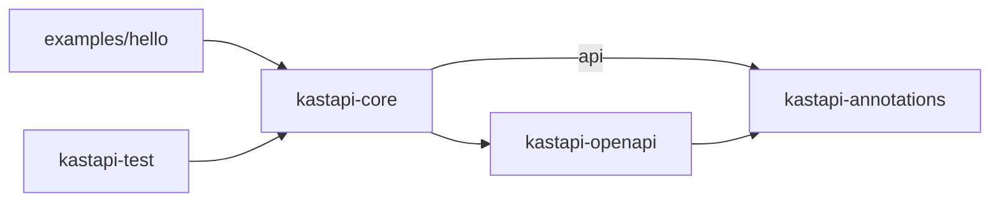
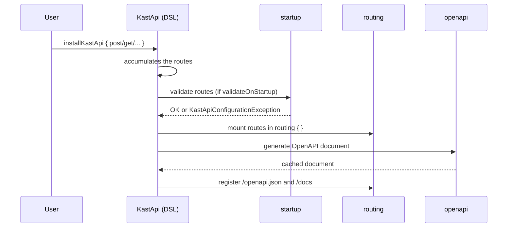
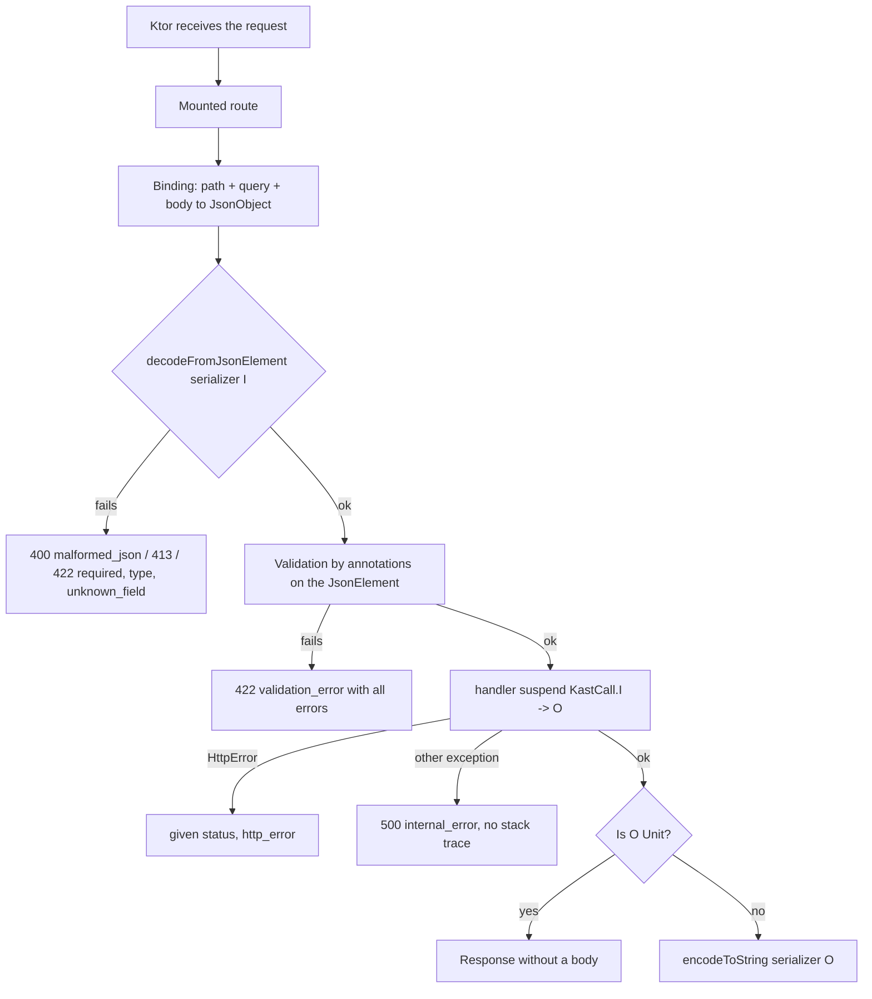
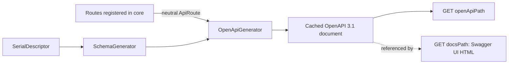

# KastAPI architecture

This document explains how KastAPI 0.1 is built and why. For the public behavior, see the [reference](reference.md); for design decisions, see the [ADRs](adr/).

---

## 1. Core idea

The handler's types are the contract. An input `@Serializable` `data class` and an output one define, with no extra code:

- the binding (where each piece of data comes from: path, query or body),
- the validation (annotations),
- the serialization,
- the OpenAPI 3.1 documentation.

```kotlin
post<CreateUser, UserResponse>("/users", status = 201) { body -> ... }
```

Principles that guide the design:

1. **The signature is the contract.** Input and output types define validation and documentation.
2. **Early errors.** Startup errors are preferred over per-request errors.
3. **Hello world in a few lines**, with Swagger working.
4. **Idiomatic Kotlin.** Null-safety and default values express what is optional; `data class` for models; `suspend` for asynchrony.
5. **No lock-in.** You can always drop down to plain Ktor.
6. **Clear errors**, readable for people and structured for machines.

---

## 2. Modules



| Module | Responsibility | Root package | Visibility |
| --- | --- | --- | --- |
| `kastapi-annotations` | Validation annotations (`@Min`, `@Max`, `@Length`, `@NotBlank`, `@Email`, `@Pattern`) | `dev.kastapi.validation` | Public |
| `kastapi-core` | DSL, binding, validation, errors, mounting in Ktor and startup validation | `dev.kastapi` | Public (DSL) and `internal` (the rest) |
| `kastapi-openapi` | Schemas, OpenAPI document and Swagger UI HTML | `dev.kastapi.openapi` | Public only because of a Kotlin limitation across modules (see section 9) |
| `kastapi-test` | `kastTest` and `KastTestClient` | `dev.kastapi.test` | Public |
| `examples/hello` | Runnable application of the "Hello world" | | Not published and excluded from `apiCheck` |

**Why `kastapi-annotations` exists.** `core` needs the annotations to validate and `openapi` to document them, but `openapi` must not depend on `core`. A small separate module avoids the cycle. `core` exposes it with `api(...)`, so whoever uses the library does not have to declare it. In the future it could be multiplatform.

**Dependency rule.** `openapi` does not know `core`: it receives a neutral route model (`ApiRoute`) and returns the document.

---

## 3. Package structure

```
dev.kastapi
├── KastApi.kt          Public DSL: kastApi(), installKastApi(), get/post/put/patch/delete, group, info
├── KastApiConfig.kt    Public configuration
├── KastCall.kt         Handler receiver (call, header)
├── HttpError.kt        Public exception
├── NoInput.kt          @Serializable object for routes without input
├── routing/            Route definition and mounting in Ktor      (internal)
├── binding/            path, query, body → JsonObject → I         (internal)
├── validation/         Validation engine                          (internal)
├── errors/             Error format, StatusPages and messages     (internal)
├── startup/            Startup validations                        (internal)
└── docs/               Mounting of /openapi.json and /docs        (internal)

dev.kastapi.validation  (kastapi-annotations) public annotations
dev.kastapi.openapi     SchemaGenerator, OpenApiGenerator, SwaggerUi
dev.kastapi.test        kastTest, KastTestClient
```

Everything public is declared explicitly `public` (`explicitApi()`); the rest is `internal`.

---

## 4. Application lifecycle



1. Each call to `get`, `post`... stores a route draft with the method, the path, the input and output serializers, the metadata, the status and the handler.
2. When the block ends, `startup/StartupValidator` computes each route's plan (`RoutePlan`) and gathers the configuration problems.
3. The routes are mounted in Ktor's `routing { }`.
4. The OpenAPI document is generated once and `openApiPath` and `docsPath` are registered.

`kastApi(...)` starts Netty with `wait = true` and calls `installKastApi`; tests use `installKastApi` inside `testApplication`.

### Startup errors

With `validateOnStartup = true`, `KastApiConfigurationException` is thrown with **all** the problems in the message:

- A route `{param}` without a property in the input.
- A nullable path property or one with a default value.
- An unsupported type in path or query.
- A duplicate method and route.
- An annotation on an incompatible type (for example, `@Email` on an `Int`).
- A `GET` route that matches `docsPath` or `openApiPath`.

Problems are of two kinds. **Fatal** ones prevent building the route: a type that cannot be bound from path or query, an input that is not a `data class`, and an invalid `@Pattern` regex. **Consistency** problems are the rest. With `validateOnStartup = false` only the fatal ones are reported, because without them the route could not work.

- Two routes are duplicates if they have the same method and the same template, ignoring parameter names (`/u/{id}` and `/u/{key}` match the same URLs).
- `@Min` and `@Max` apply to numeric types; `@Length`, to `String` and `List`; `@NotBlank`, `@Email` and `@Pattern`, to `String`. A `value class` is evaluated by the type it wraps.
- The message starts with `KastAPI found N configuration problems:` and lists one problem per line, each with `METHOD /path`. `KastApiConfigurationException` does not expose the list of problems, only the message.
- `@Pattern` regexes are compiled once, in this phase.

---

## 5. Request flow



### 5.1 Binding

| Method | `{path}` properties | Remaining properties |
| --- | --- | --- |
| GET, DELETE | path | query string |
| POST, PUT, PATCH without path properties | | all of `I` is the JSON body |
| POST, PUT, PATCH with path properties | path | JSON body |

- Path and query values arrive as text and are converted according to the property type: `String`, `Int`, `Long`, `Double`, `Boolean`, `enum` (by serialized name) and, in query, `List<T>` of those types (`?tag=a&tag=b`).
- Optional = with a default value or nullable. Required = without a default value and not nullable.
- Nested objects in path or query are not supported (startup error).
- A `JsonObject` is built and decoded with `json.decodeFromJsonElement(serializer<I>(), ...)` ([ADR-0002](adr/0002-serialdescriptor-no-reflection.md)).
- Before decoding, `binding/BodyValidator` walks the `SerialDescriptor` against the body's JSON and collects all errors (`required`, `type`, `unknown_field`), with `field` in dot and index notation.
- A body that is not valid JSON responds `400 malformed_json`; an empty one is treated as `{}`.
- If a property appears as `{name}` in the route, it is read from the URL and the value the body carries for that name is ignored.
- The body is read with a limit (`maxBodyBytes`, 1 MiB by default). With a larger `Content-Length` it is rejected without reading; without it, at most `maxBodyBytes + 1` bytes are read. If exceeded, it responds `413 payload_too_large`.

### 5.2 Validation

- Source: `SerialDescriptor.getElementAnnotations(i)` plus the already decoded `JsonElement`.
- Nested properties and elements of lists of objects are walked.
- `null` in optional properties is not validated.
- **All** errors are collected, not just the first one.

| Annotation | Types | Rule | `code` |
| --- | --- | --- | --- |
| `@Min(Long)` | numeric | `>= value` | `min` |
| `@Max(Long)` | numeric | `<= value` | `max` |
| `@Length(min, max)` | `String`, `List` | length in range | `length` |
| `@NotBlank` | `String` | not empty and not only whitespace | `not_blank` |
| `@Email` | `String` | `something@domain.ext`, no spaces | `email` |
| `@Pattern(regex)` | `String` | full match | `pattern` |

When a route is registered, `validation/RuleSet` walks the input's `SerialDescriptor` (including nested classes, lists and maps) and turns each property's annotations into rules (`validation/Rule`), compiling the regexes only once. On each request the rules are applied to body, path and query, and the error's `location` is the property's origin. Only values that passed structural validation are evaluated.

`@Min` and `@Max` compare integers exactly and decimals against the value converted to `Double`. `@Email` is evaluated in a single pass, without a regex, to avoid quadratic cost on hostile inputs. `@Pattern` uses the regex the developer writes: a pattern with catastrophic backtracking remains their responsibility.

### 5.3 Response and errors

Single format (`application/json`):

```json
{
  "status": 422,
  "error": "validation_error",
  "message": "The request has 2 validation errors",
  "details": [
    { "location": "body", "field": "age", "code": "min", "message": "must be greater than or equal to 18", "value": 15 }
  ]
}
```

| Case | Status | `error` |
| --- | --- | --- |
| Malformed JSON | 400 | `malformed_json` |
| Missing field, wrong type, unknown field or failed annotation | 422 | `validation_error` |
| Body larger than `maxBodyBytes` | 413 | `payload_too_large` |
| Unknown route | 404 | `not_found` |
| Method not allowed on an existing route | 405 | `method_not_allowed` |
| `throw HttpError(status, msg)` | the given one | `http_error` |
| Unhandled exception | 500 | `internal_error` |

- `location` is `path`, `query` or `body`. `field` uses dots and indexes: `items[2].name`.
- The 500 never includes the stack trace in the body; it is logged with the application's logger, with the method, the path and the exception. An `HttpError` is not logged as a server error.
- The 404, the 405, `HttpError` and the 500 are resolved by `StatusPages`, which `installKastApi` installs (`errors/ErrorPages.kt`). The 400, 413 and 422 from binding and validation are answered inside the route itself.
- If the application already installed its own `StatusPages`, KastAPI does not install its own and respects its handlers. The application's `StatusPages` must be installed **before** `installKastApi`.
- `kastapi-core` does not ship a logging implementation (SLF4J): the application must provide one, for example Logback, to see the 500 log entry.
- All texts (English in 0.1) live in a single file: `errors/Messages.kt`.

---

## 6. OpenAPI generation



### 6.1 Schemas

`SchemaGenerator` (`kastapi-openapi`, `internal`) accumulates the components of a document.

- `schemaOf(descriptor)` returns a type's schema: inline for primitives, lists, maps and enums, and a `$ref` reference for classes, whose definition goes in `components`.
- A class's name is reserved **before** generating its properties, which breaks the cycles of recursive types. Two classes are the same if they have the same name and properties with the same types, so `Box<Int>` and `Box<String>` are distinct components.
- Names: the simple one (`User`); if it already exists, the full one (`dev.app.User`); if that also exists, the full one with a suffix (`_2`).
- Primitives with `format` (`int32`, `int64`, `float`, `double`); `Char` as a string of length 1. Nullable: `type: [X, "null"]`, and `oneOf: [{$ref}, {type: "null"}]` for a class. `required` are the properties without a default value and not nullable.
- Annotations are reflected as follows: `@Min`→`minimum`, `@Max`→`maximum`, `@Length`→`minLength`/`maxLength` or `minItems`/`maxItems`, `@Pattern`→`pattern`, `@Email`→`format: email` and `@NotBlank`→`minLength: 1`. Those that do not apply to the type are ignored (startup already rejects them).
- Limitations: `sealed`, polymorphic and contextual types generate `{}`; default values are not documented, because descriptors do not expose them ([ADR-0002](adr/0002-serialdescriptor-no-reflection.md)).

### 6.2 Document

- When `installKastApi` finishes, `core` translates each route into a neutral `ApiRoute` (`docs/Documentation.kt`): method, route, metadata, parameters classified as `path` or `query` (with their `required`), body, output and whether the route has input. `openapi` also receives the standard error's descriptor for the 422 response.
- `OpenApiGenerator.generate` builds the document as a `JsonObject` (`openapi: 3.1.0`, `info`, `paths`, `components.schemas`). It is generated **once** at startup and served from memory.
- An operation carries `tags`, `summary`, `description`, `operationId` (`get_users_id`; the root is `get_root` and a duplicate gets `_2`), `parameters`, `requestBody` and `responses`. Parameters do not admit `null`: an absent value already equals `null`.
- If the input mixes path and body properties, the `requestBody` points to a derived component `<Name>Body` without the path properties. The body is `required` only if it has some property without a default value and not nullable.
- The success response uses the declared status and the standard phrase as `description`; a `Unit` output has no `content`. Every operation with input adds the `422` response with `ErrorResponse` (and `ErrorDetail` as a component).
- `docsPath` serves the HTML from `swaggerUiHtml`: `swagger-ui-dist` 5.34.1 from jsDelivr, with a pinned version and SRI hashes, and with the schema path escaped for the `<script>`. It is not a Gradle dependency.
- `openApiPath = null` disables the schema and `/docs` too; `docsPath = null` disables only the interface. The documentation routes do not appear in the document.

---

## 7. Ktor integration

KastAPI is a layer on top of Ktor ([ADR-0001](adr/0001-build-on-ktor.md)): it uses Netty by default, routing, content negotiation and status pages.

- `Application.installKastApi` allows integrating into an existing application.
- `KastCall.call` gives access to the `ApplicationCall` (the way out to plain Ktor).
- `installKastApi` installs `StatusPages` only if the application does not have it already (see section 5.3).
- Other plugins (CORS, authentication, metrics) are installed directly in Ktor.

---

## 8. Design decisions

| ADR | Decision | Reason | Accepted cost |
| --- | --- | --- | --- |
| [0001](adr/0001-build-on-ktor.md) | Build on Ktor | Do not reinvent the server, engines, TLS or testing | Depends on the evolution of Ktor's API |
| [0002](adr/0002-serialdescriptor-no-reflection.md) | `SerialDescriptor` instead of `kotlin-reflect` | No reflection: fast startup and compatible with R8 and GraalVM | Models must be `@Serializable`; no default values in OpenAPI |
| [0003](adr/0003-reified-dsl-before-ksp.md) | DSL with `reified` types in 0.1, KSP in 0.3 | No code generation; fast iteration | One `data class` per endpoint with input |
| [0004](adr/0004-annotations-module.md) | `kastapi-annotations` module | Module graph without cycles | One extra small module |

---

## 9. Visibility across modules

In Kotlin, `internal` is not visible across Gradle modules, and `kastapi-core` needs to call `kastapi-openapi`. That is why the classes `core` uses from `openapi` (`ApiRoute`, `OpenApiGenerator`, `swaggerUiHtml`, etc.) are public but carry the `@InternalKastApi` marker, a `@RequiresOptIn` of level `ERROR`. `core` and `openapi` opt in with a compiler argument, and `apiValidation.nonPublicMarkers` excludes them from the `.api`. That way they are not part of the stable API.

---

## 10. Quality and stability

- Idiomatic Kotlin, ktlint and JVM 21 (`jvmToolchain(21)`).
- `explicitApi()` and warnings as errors in the library modules.
- `binary-compatibility-validator`: `apiCheck` runs in CI and excludes `examples`. It does not cover the DSL's `inline reified` functions (`get`, `post`, `bodyAs`...), which are covered by compiling the example and the tests.
- Handlers are always `suspend`.
- No `kotlin-reflect` on the per-request path.
- `kastTest` creates a `testApplication`, installs KastAPI with `installKastApi` and a client with JSON ContentNegotiation that uses the same `Json` from `KastApiConfig`. `KastTestClient`'s constructor is `internal`.
- `examples/hello` reproduces the "Hello world" of the [reference](reference.md) verbatim (default package, no ktlint) and a test compares it with it.
- Publishing: the four library modules are published to Maven Central through the Central Portal with the `com.vanniktech.maven.publish` plugin, configured in the root `build.gradle.kts`. Artifacts are signed only when a signing key is configured, so normal builds need no secrets. `publishToMavenLocal` installs them locally for testing.

### External dependencies

| Module | Dependencies |
| --- | --- |
| core | ktor-server-core, ktor-server-netty, ktor-server-content-negotiation, ktor-server-status-pages, ktor-serialization-kotlinx-json, kotlinx-serialization-json |
| openapi and annotations | kotlinx-serialization-json |
| test | kastapi-core, ktor-server-test-host, ktor-client-content-negotiation |
| tests | kotlin-test, ktor-server-test-host |

Versions are pinned in `gradle/libs.versions.toml` and are always stable.

---

## 11. Out of scope for 0.1

Dependency injection, authentication, typed headers and cookies, forms and files, WebSockets, KSP, a generated client, API versioning and CORS of its own. The following phases are in the [roadmap](ROADMAP.md) and the current status is in [STATUS.md](STATUS.md).
