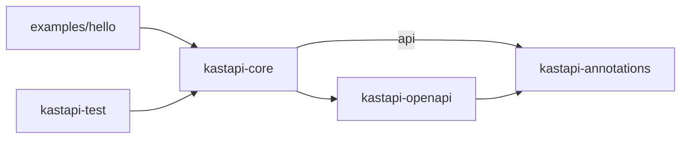
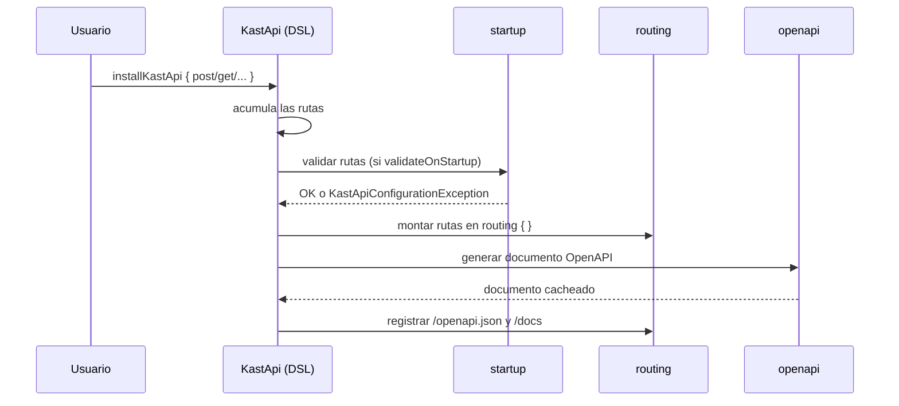
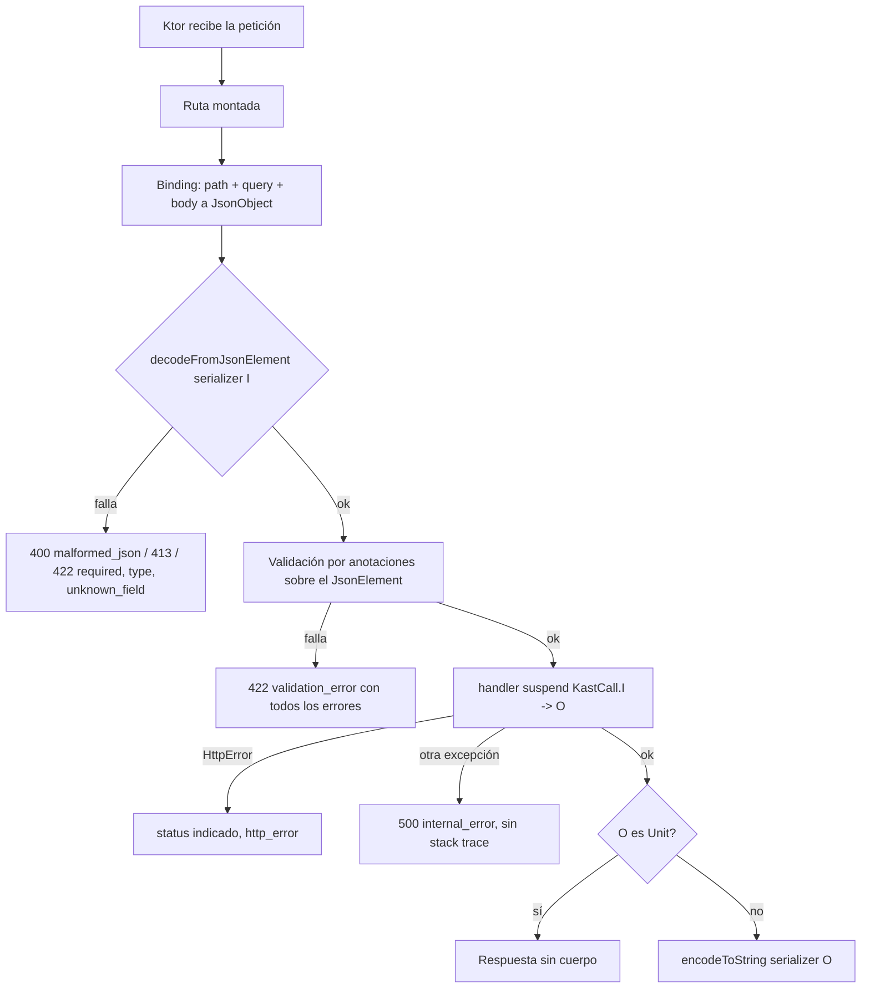
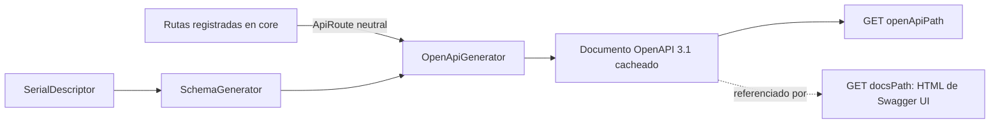

# Arquitectura de KastAPI

Este documento explica cómo está construido KastAPI 0.1 y por qué. Para el comportamiento público, consulta la [referencia](reference.md); para las decisiones de diseño, los [ADR](adr/).

---

## 1. Idea central

Los tipos del handler son el contrato. Una `data class` `@Serializable` de entrada y otra de salida definen, sin código extra:

- el binding (de dónde sale cada dato: path, query o body),
- la validación (anotaciones),
- la serialización,
- la documentación OpenAPI 3.1.

```kotlin
post<CreateUser, UserResponse>("/users", status = 201) { body -> ... }
```

Principios que guían el diseño:

1. **La firma es el contrato.** Los tipos de entrada y salida definen validación y documentación.
2. **Errores tempranos.** Se prefieren los errores al arrancar sobre los errores por petición.
3. **Hola mundo en pocas líneas**, con Swagger funcionando.
4. **Kotlin idiomático.** Null-safety y valores por defecto expresan lo opcional; `data class` para los modelos; `suspend` para la asincronía.
5. **Sin encierro.** Siempre se puede bajar a Ktor puro.
6. **Errores claros**, legibles para personas y estructurados para máquinas.

---

## 2. Módulos



| Módulo | Responsabilidad | Paquete raíz | Visibilidad |
| --- | --- | --- | --- |
| `kastapi-annotations` | Anotaciones de validación (`@Min`, `@Max`, `@Length`, `@NotBlank`, `@Email`, `@Pattern`) | `dev.kastapi.validation` | Pública |
| `kastapi-core` | DSL, binding, validación, errores, montaje en Ktor y validación de arranque | `dev.kastapi` | Pública (DSL) e `internal` (el resto) |
| `kastapi-openapi` | Esquemas, documento OpenAPI y HTML de Swagger UI | `dev.kastapi.openapi` | Pública solo por una limitación de Kotlin entre módulos (ver sección 9) |
| `kastapi-test` | `kastTest` y `KastTestClient` | `dev.kastapi.test` | Pública |
| `examples/hello` | Aplicación ejecutable del "Hola mundo" | | No publicada y excluida de `apiCheck` |

**Por qué existe `kastapi-annotations`.** `core` necesita las anotaciones para validar y `openapi` para documentarlas, pero `openapi` no debe depender de `core`. Un módulo pequeño aparte evita el ciclo. `core` lo expone con `api(...)`, para que quien usa la librería no tenga que declararlo. A futuro podría ser multiplataforma.

**Regla de dependencia.** `openapi` no conoce `core`: recibe un modelo neutral de rutas (`ApiRoute`) y devuelve el documento.

---

## 3. Estructura de paquetes

```
dev.kastapi
├── KastApi.kt          DSL público: kastApi(), installKastApi(), get/post/put/patch/delete, group, info
├── KastApiConfig.kt    configuración pública
├── KastCall.kt         receptor del handler (call, header)
├── HttpError.kt        excepción pública
├── NoInput.kt          objeto @Serializable para rutas sin entrada
├── routing/            definición de rutas y montaje en Ktor      (internal)
├── binding/            path, query y body → JsonObject → I        (internal)
├── validation/         motor de validación                        (internal)
├── errors/             formato de error, StatusPages y mensajes   (internal)
├── startup/            validaciones al arrancar                   (internal)
└── docs/               montaje de /openapi.json y /docs           (internal)

dev.kastapi.validation  (kastapi-annotations) anotaciones públicas
dev.kastapi.openapi     SchemaGenerator, OpenApiGenerator, SwaggerUi
dev.kastapi.test        kastTest, KastTestClient
```

Todo lo público se declara `public` de forma explícita (`explicitApi()`); lo demás es `internal`.

---

## 4. Ciclo de vida de la aplicación



1. Cada llamada a `get`, `post`... guarda un borrador de ruta con el método, el path, los serializadores de entrada y salida, los metadatos, el status y el handler.
2. Al terminar el bloque, `startup/StartupValidator` calcula el plan de cada ruta (`RoutePlan`) y reúne los problemas de configuración.
3. Se montan las rutas en el `routing { }` de Ktor.
4. Se genera una sola vez el documento OpenAPI y se registran `openApiPath` y `docsPath`.

`kastApi(...)` arranca Netty con `wait = true` y llama a `installKastApi`; las pruebas usan `installKastApi` dentro de `testApplication`.

### Errores de arranque

Con `validateOnStartup = true` se lanza `KastApiConfigurationException` con **todos** los problemas en el mensaje:

- `{param}` de la ruta sin propiedad en la entrada.
- Propiedad de path nullable o con valor por defecto.
- Tipo no soportado en path o query.
- Método y ruta duplicados.
- Anotación en un tipo incompatible (por ejemplo, `@Email` en un `Int`).
- Ruta `GET` que coincide con `docsPath` u `openApiPath`.

Los problemas son de dos tipos. Los **fatales** impiden construir la ruta: un tipo que no se puede enlazar desde path o query, una entrada que no es una `data class` y un regex de `@Pattern` inválido. Los de **consistencia** son el resto. Con `validateOnStartup = false` solo se reportan los fatales, porque sin ellos la ruta no podría funcionar.

- Dos rutas son duplicadas si tienen el mismo método y la misma plantilla sin contar los nombres de los parámetros (`/u/{id}` y `/u/{key}` casan las mismas URLs).
- `@Min` y `@Max` aplican a tipos numéricos; `@Length`, a `String` y `List`; `@NotBlank`, `@Email` y `@Pattern`, a `String`. Una `value class` se evalúa por el tipo que envuelve.
- El mensaje empieza con `KastAPI encontró N problemas de configuración:` y lista un problema por línea, cada uno con `METHOD /ruta`. `KastApiConfigurationException` no expone la lista de problemas, solo el mensaje.
- Los regex de `@Pattern` se compilan una sola vez, en esta fase.

---

## 5. Flujo de una petición



### 5.1 Binding

| Método | Propiedades de `{path}` | Resto de propiedades |
| --- | --- | --- |
| GET, DELETE | path | query string |
| POST, PUT, PATCH sin propiedades de path | | todo `I` es el cuerpo JSON |
| POST, PUT, PATCH con propiedades de path | path | cuerpo JSON |

- Los valores de path y query llegan como texto y se convierten según el tipo de la propiedad: `String`, `Int`, `Long`, `Double`, `Boolean`, `enum` (por nombre serializado) y, en query, `List<T>` de esos tipos (`?tag=a&tag=b`).
- Opcional = con valor por defecto o nullable. Requerida = sin valor por defecto y no nullable.
- Los objetos anidados en path o query no se soportan (error de arranque).
- Se construye un `JsonObject` y se decodifica con `json.decodeFromJsonElement(serializer<I>(), ...)` ([ADR-0002](adr/0002-serialdescriptor-sin-reflexion.md)).
- Antes de decodificar, `binding/BodyValidator` recorre el `SerialDescriptor` contra el JSON del cuerpo y recoge todos los errores (`required`, `type`, `unknown_field`), con el `field` en notación de puntos e índices.
- Un cuerpo que no es JSON válido responde `400 malformed_json`; uno vacío se trata como `{}`.
- Si una propiedad aparece como `{nombre}` en la ruta, se lee de la URL y el valor que traiga el cuerpo para ese nombre se ignora.
- El cuerpo se lee con un límite (`maxBodyBytes`, 1 MiB por defecto). Con `Content-Length` mayor se rechaza sin leer; sin él se leen como máximo `maxBodyBytes + 1` bytes. Si se supera, responde `413 payload_too_large`.

### 5.2 Validación

- Fuente: `SerialDescriptor.getElementAnnotations(i)` más el `JsonElement` ya decodificado.
- Se recorren las propiedades anidadas y los elementos de las listas de objetos.
- Los `null` en propiedades opcionales no se validan.
- Se recolectan **todos** los errores, no solo el primero.

| Anotación | Tipos | Regla | `code` |
| --- | --- | --- | --- |
| `@Min(Long)` | numéricos | `>= value` | `min` |
| `@Max(Long)` | numéricos | `<= value` | `max` |
| `@Length(min, max)` | `String`, `List` | longitud en rango | `length` |
| `@NotBlank` | `String` | no vacío ni solo espacios | `not_blank` |
| `@Email` | `String` | `algo@dominio.ext`, sin espacios | `email` |
| `@Pattern(regex)` | `String` | coincidencia completa | `pattern` |

Al registrar una ruta, `validation/RuleSet` recorre el `SerialDescriptor` de la entrada (incluidas las clases anidadas, listas y mapas) y convierte las anotaciones de cada propiedad en reglas (`validation/Rule`), compilando los regex una sola vez. En cada petición las reglas se aplican en body, path y query, y el `location` del error es el del origen de la propiedad. Solo se evalúan valores que pasaron la validación estructural.

`@Min` y `@Max` comparan enteros de forma exacta y decimales contra el valor convertido a `Double`. `@Email` se evalúa en una sola pasada, sin regex, para evitar un coste cuadrático ante entradas hostiles. `@Pattern` usa el regex que escribe el desarrollador: un patrón con backtracking catastrófico sigue siendo su responsabilidad.

### 5.3 Respuesta y errores

Formato único (`application/json`):

```json
{
  "status": 422,
  "error": "validation_error",
  "message": "La petición tiene 2 errores de validación",
  "details": [
    { "location": "body", "field": "age", "code": "min", "message": "debe ser mayor o igual a 18", "value": 15 }
  ]
}
```

| Caso | Status | `error` |
| --- | --- | --- |
| JSON mal formado | 400 | `malformed_json` |
| Falta un campo, tipo incorrecto, campo desconocido o anotación fallida | 422 | `validation_error` |
| Cuerpo mayor que `maxBodyBytes` | 413 | `payload_too_large` |
| Ruta inexistente | 404 | `not_found` |
| Método no permitido en una ruta que existe | 405 | `method_not_allowed` |
| `throw HttpError(status, msg)` | el indicado | `http_error` |
| Excepción no controlada | 500 | `internal_error` |

- `location` es `path`, `query` o `body`. `field` usa puntos e índices: `items[2].name`.
- El 500 nunca incluye el stack trace en el cuerpo; se registra con el logger de la aplicación, con el método, la ruta y la excepción. Un `HttpError` no se registra como error del servidor.
- El 404, el 405, `HttpError` y el 500 los resuelve `StatusPages`, que instala `installKastApi` (`errors/ErrorPages.kt`). Los 400, 413 y 422 de binding y validación se responden dentro de la propia ruta.
- Si la aplicación ya instaló su `StatusPages`, KastAPI no instala el suyo y respeta sus manejadores. El `StatusPages` propio debe instalarse **antes** de `installKastApi`.
- `kastapi-core` no trae una implementación de logging (SLF4J): la aplicación debe aportar una, por ejemplo Logback, para ver el registro del 500.
- Todos los textos (español en 0.1) viven en un solo archivo: `errors/Messages.kt`.

---

## 6. Generación de OpenAPI



### 6.1 Esquemas

`SchemaGenerator` (`kastapi-openapi`, `internal`) acumula los componentes de un documento.

- `schemaOf(descriptor)` devuelve el esquema de un tipo: en línea para primitivos, listas, mapas y enums, y una referencia `$ref` para las clases, cuya definición queda en `components`.
- El nombre de una clase se reserva **antes** de generar sus propiedades, lo que corta los ciclos de los tipos recursivos. Dos clases son la misma si tienen igual nombre y propiedades con los mismos tipos, así que `Box<Int>` y `Box<String>` son componentes distintos.
- Nombres: el simple (`User`); si ya existe, el completo (`dev.app.User`); si también existe, el completo con sufijo (`_2`).
- Primitivos con `format` (`int32`, `int64`, `float`, `double`); `Char` como cadena de longitud 1. Nullable: `type: [X, "null"]`, y `oneOf: [{$ref}, {type: "null"}]` para una clase. `required` son las propiedades sin valor por defecto y no nullable.
- Las anotaciones se reflejan así: `@Min`→`minimum`, `@Max`→`maximum`, `@Length`→`minLength`/`maxLength` o `minItems`/`maxItems`, `@Pattern`→`pattern`, `@Email`→`format: email` y `@NotBlank`→`minLength: 1`. Las que no corresponden al tipo se ignoran (el arranque ya las rechaza).
- Limitaciones: los tipos `sealed`, polimórficos y contextuales generan `{}`; los valores por defecto no se documentan, porque los descriptores no los exponen ([ADR-0002](adr/0002-serialdescriptor-sin-reflexion.md)).

### 6.2 Documento

- Al terminar `installKastApi`, `core` traduce cada ruta a un `ApiRoute` neutral (`docs/Documentation.kt`): método, ruta, metadatos, parámetros clasificados como `path` o `query` (con su `required`), cuerpo, salida y si la ruta tiene entrada. `openapi` recibe también el descriptor del error estándar para la respuesta 422.
- `OpenApiGenerator.generate` construye el documento como `JsonObject` (`openapi: 3.1.0`, `info`, `paths`, `components.schemas`). Se genera **una sola vez** al arrancar y se sirve desde memoria.
- Una operación lleva `tags`, `summary`, `description`, `operationId` (`get_users_id`; la raíz es `get_root` y un duplicado recibe `_2`), `parameters`, `requestBody` y `responses`. Los parámetros no admiten `null`: un valor ausente ya equivale a `null`.
- Si la entrada mezcla propiedades de path y de cuerpo, el `requestBody` apunta a un componente derivado `<Nombre>Body` sin las propiedades de path. El cuerpo es `required` solo si tiene alguna propiedad sin valor por defecto y no nullable.
- La respuesta exitosa usa el status declarado y la frase estándar como `description`; una salida `Unit` no lleva `content`. Toda operación con entrada añade la respuesta `422` con `ErrorResponse` (y `ErrorDetail` como componente).
- `docsPath` sirve el HTML de `swaggerUiHtml`: `swagger-ui-dist` 5.34.1 desde jsDelivr, con versión fija y hashes SRI, y con la ruta del esquema escapada para el `<script>`. No es una dependencia de Gradle.
- `openApiPath = null` desactiva el esquema y también `/docs`; `docsPath = null` desactiva solo la interfaz. Las rutas de documentación no aparecen en el documento.

---

## 7. Integración con Ktor

KastAPI es una capa sobre Ktor ([ADR-0001](adr/0001-construir-sobre-ktor.md)): usa Netty por defecto, routing, content negotiation y status pages.

- `Application.installKastApi` permite integrarse en una aplicación existente.
- `KastCall.call` da acceso al `ApplicationCall` (la salida hacia Ktor puro).
- `installKastApi` instala `StatusPages` solo si la aplicación no lo tiene ya (ver la sección 5.3).
- Otros plugins (CORS, autenticación, métricas) se instalan directamente en Ktor.

---

## 8. Decisiones de diseño

| ADR | Decisión | Razón | Costo aceptado |
| --- | --- | --- | --- |
| [0001](adr/0001-construir-sobre-ktor.md) | Construir sobre Ktor | No reinventar servidor, engines, TLS ni testing | Depende de la evolución de la API de Ktor |
| [0002](adr/0002-serialdescriptor-sin-reflexion.md) | `SerialDescriptor` en lugar de `kotlin-reflect` | Sin reflexión: arranque rápido y compatible con R8 y GraalVM | Los modelos deben ser `@Serializable`; sin valores por defecto en OpenAPI |
| [0003](adr/0003-dsl-reified-antes-que-ksp.md) | DSL con tipos `reified` en 0.1, KSP en 0.3 | Sin generación de código; iteración rápida | Una `data class` por endpoint con entrada |
| [0004](adr/0004-modulo-anotaciones.md) | Módulo `kastapi-annotations` | Grafo de módulos sin ciclos | Un módulo extra pequeño |

---

## 9. Visibilidad entre módulos

En Kotlin lo `internal` no se ve entre módulos de Gradle, y `kastapi-core` necesita llamar a `kastapi-openapi`. Por eso las clases que `core` usa de `openapi` (`ApiRoute`, `OpenApiGenerator`, `swaggerUiHtml`, etc.) son públicas pero llevan el marcador `@InternalKastApi`, un `@RequiresOptIn` de nivel `ERROR`. `core` y `openapi` se acogen al opt-in con un argumento del compilador, y `apiValidation.nonPublicMarkers` las excluye del `.api`. Así no forman parte de la API estable.

---

## 10. Calidad y estabilidad

- Kotlin idiomático, ktlint y JVM 21 (`jvmToolchain(21)`).
- `explicitApi()` y warnings como errores en los módulos de librería.
- `binary-compatibility-validator`: `apiCheck` se ejecuta en CI y excluye `examples`. No cubre las funciones `inline reified` del DSL (`get`, `post`, `bodyAs`...), que cubre la compilación del ejemplo y de las pruebas.
- Los handlers son siempre `suspend`.
- Sin `kotlin-reflect` en el camino de cada petición.
- `kastTest` crea un `testApplication`, instala KastAPI con `installKastApi` y un cliente con ContentNegotiation JSON que usa el mismo `Json` de `KastApiConfig`. El constructor de `KastTestClient` es `internal`.
- `examples/hello` reproduce el "Hola mundo" de la [referencia](reference.md) literalmente (paquete por defecto, sin ktlint) y una prueba lo compara con ella.
- Publicación: `maven-publish` con POM y JAR de fuentes en los cuatro módulos de librería, configurado en el `build.gradle.kts` raíz. Por ahora solo se publica en el repositorio Maven local (`publishToMavenLocal`).

### Dependencias externas

| Módulo | Dependencias |
| --- | --- |
| core | ktor-server-core, ktor-server-netty, ktor-server-content-negotiation, ktor-server-status-pages, ktor-serialization-kotlinx-json, kotlinx-serialization-json |
| openapi y annotations | kotlinx-serialization-json |
| test | kastapi-core, ktor-server-test-host, ktor-client-content-negotiation |
| pruebas | kotlin-test, ktor-server-test-host |

Las versiones se fijan en `gradle/libs.versions.toml` y son siempre estables.

---

## 11. Fuera de alcance de 0.1

Inyección de dependencias, autenticación, headers y cookies tipados, formularios y archivos, WebSockets, KSP, cliente generado, versionado de API y CORS propio. Las fases siguientes están en el [roadmap](ROADMAP.md) y el estado actual, en [STATUS.md](STATUS.md).
